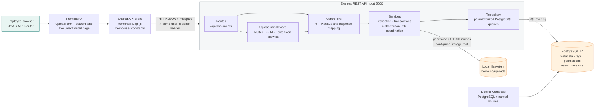

# DigiDocs architecture and design rationale

This document describes the architecture that is actually implemented in the
DigiDocs proof of concept. The required technologies from the assessment are
used as the implementation stack; the design decisions below explain how the
components are organized and why.

## System architecture

### Runtime boundaries

- The browser owns presentation state and sends requests through the shared
  frontend API helper in [frontend/lib/api.js](../frontend/lib/api.js).
- Next.js is the required App Router frontend. The interactive upload/search
  screens are split into reusable client components in
  [frontend/app/components/](../frontend/app/components/).
- Express is the required backend framework. Routes connect middleware to
  controllers in [backend/src/routes/documentRoutes.js](../backend/src/routes/documentRoutes.js).
- Controllers translate HTTP input/output and delegate business work to
  [backend/src/services/documentService.js](../backend/src/services/documentService.js).
- Services validate input, coordinate transactions, enforce access rules, and
  coordinate database/file operations.
- Repositories in [backend/src/repositories/documentRepository.js](../backend/src/repositories/documentRepository.js)
  contain PostgreSQL access and parameterized SQL only.
- PostgreSQL stores metadata and relationships. File bytes are stored on the
  local filesystem, while the database stores each version's generated path
  and original filename.

## Why the backend is layered

The application keeps HTTP concerns, business rules, and SQL separate because
they change for different reasons:

1. Routes define endpoint composition and upload middleware.
2. Controllers handle request parsing, status codes, response shape, and
   cleanup callbacks.
3. Services own validation, authorization, transaction boundaries, version
   allocation, and storage coordination.
4. Repositories own SQL and database result retrieval.

This structure makes the business rules testable without coupling them to a
particular route and makes it possible to replace the local filesystem or the
demo identity mechanism later without rewriting the SQL layer.

## Data model and integrity

The normalized schema in [database/schema.sql](../database/schema.sql) uses:

- `users` linked to `departments`.
- `documents` linked to the uploading user.
- `tags` and `document_tags` for the document/tag many-to-many relationship.
- `document_versions` for immutable file history and unique per-document
  version numbers.
- `document_permissions` for the document/department many-to-many access list.

Foreign keys protect relationships, composite primary keys prevent duplicate
tag/permission links, and `UNIQUE (document_id, version_number)` prevents
duplicate version numbers. Version uploads lock the parent document with
`FOR UPDATE` before calculating the next number, so concurrent uploads are
serialized for the same document.

Search uses PostgreSQL parameterized queries, bounded `limit`/`offset`
pagination, and trigram indexes for substring search. The migration in
[database/migrations/001_search_indexes.sql](../database/migrations/001_search_indexes.sql)
updates existing databases without deleting data.

## File storage and consistency

Multer writes files to a configurable storage root. The default is
`backend/uploads`; integration tests inject a temporary directory. Physical
filenames are generated with UUIDs, so user-controlled original names are not
used as filesystem paths. Original names are retained only as download/display
metadata.

The backend limits uploads to 25 MB and accepts PDF, DOCX, TXT, and XLSX
extensions. The service stores the database records inside a PostgreSQL
transaction. If validation or a database operation fails, the controller
removes the newly written file. This is best-effort compensation: PostgreSQL
cannot roll back a filesystem write after a process crash, so production would
need reconciliation or object-storage lifecycle handling.

Downloads never expose the stored path directly. The service first performs
the same access query used by document details, resolves the configured
storage root, uses the generated basename, verifies the file exists, and then
passes the safe path to Express.

## Authorization model

Restricted documents are visible only when the selected demo user belongs to
one of the departments in `document_permissions`. The access predicate is
applied in repository queries used by search, details, downloads, version
uploads, and version history. Unauthorized restricted documents return an
empty search result or `404 Document not found`, preventing ID guessing from
revealing their existence.

The demo-user selector is simulated identity for the assessment only. The
`x-demo-user-id` header is user-controlled and is not secure authentication.
Upload requests additionally require the header value to match `uploaderId`.
A production implementation would replace this mechanism with authenticated
sessions or signed tokens and derive the user identity server-side.

## Request flows

### Upload

1. The frontend validates title, file selection, restriction choices, and the
   25 MB limit.
2. Multer validates the extension, enforces the 25 MB backend limit, and writes
   a UUID-named file.
3. The controller passes multipart data to the service.
4. The service validates the selected demo identity, uploader, tags,
   departments, and restriction rules.
5. A transaction inserts the document, version 1, tags, and permissions.
6. Failure rolls back database changes and removes the new physical file.

### Search

1. The frontend sends title, tag, uploader, pagination, and demo-user header.
2. The service validates identity and pagination bounds.
3. The repository applies the permission predicate before search filters.
4. PostgreSQL returns only visible documents with current-version metadata and
   pagination totals.

### Authorization and detail

The detail, history, version-upload, and download services validate the demo
user, query the document through the permission-aware repository method, and
return `404` when the document is missing or unauthorized.

### Download

The backend authorizes first, resolves the latest version by highest version
number, verifies the path is within the configured storage directory, and
streams the file through Express using the original filename as the download
name.

### New version

The version endpoint starts a transaction, locks the document row, authorizes
the user, calculates `MAX(version_number) + 1`, inserts a new immutable version,
and commits. Previous database records and physical files remain available in
the history.

## Setup architecture

[docker-compose.yml](../docker-compose.yml) starts PostgreSQL 17 with a named
volume. On a genuinely fresh volume, the official PostgreSQL image executes
the mounted schema and seed scripts in order. Existing volumes are not
reinitialized. The idempotent seed statements and the explicit search-index
migration make setup behavior clear without destroying existing development
data.

## Implemented versus future improvements

Implemented in this POC:

- Layered Express backend.
- PostgreSQL normalized schema and constraints.
- Local UUID-based file storage.
- Upload validation and compensating cleanup.
- Department-aware search, details, downloads, version uploads, and history.
- Bounded search pagination and trigram indexes.
- Next.js App Router UI with shared API utilities and reusable components.
- Isolated backend integration tests, including concurrent versions.

Intentionally deferred:

- Production authentication and role-based authorization.
- Object storage and multi-instance filesystem coordination.
- File-content inspection, malware scanning, and orphan-file reconciliation.
- Historical-version download endpoints.
- Redis caching, microservices, and duplicate-file detection.
- Advanced frontend pagination controls.

These are future production improvements, not prerequisites for the required
proof of concept.
