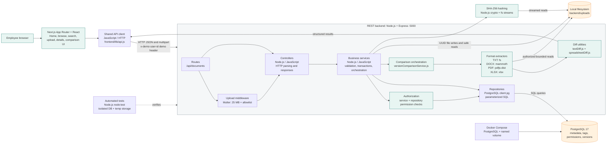

# Unpile architecture and design rationale

This document describes the architecture actually implemented in the Unpile
proof of concept. The assessment-mandated technologies are the implementation
stack; the design decisions below explain how responsibilities are separated
within that stack.

## System architecture

The frontend never parses uploaded files. It sends comparison requests through
the shared API client and renders the backend's normalized text or spreadsheet
result. Docker Compose provisions PostgreSQL; it is not in the request path.

The frontend routes are organized as follows:

- `/` is the workspace home with title search, primary actions, and a compact
  permission-filtered available-document list.
- `/search` provides title search through the existing `title` API filter plus
  optional tag and uploader filters. The `q` URL parameter is mapped to the
  backend title filter because the API does not expose one unified search
  parameter.
- `/documents` provides permission-filtered browsing with bounded API
  pagination.
- `/upload` hosts the existing upload form and preserves its validation,
  duplicate feedback, and success link.
- `/documents/:id` provides authorized metadata, version history, comparison,
  latest download, and new-version upload.

The selected demo user is shared through a small React context backed by
`localStorage` for this proof of concept. It is a simulated identity, not
production authentication; every API request still sends the existing
`x-demo-user-id` header and the backend remains the authorization boundary.

The homepage also provides a browser-local Recently viewed convenience. The
frontend stores only up to six document IDs under a key scoped to the selected
demo user. When the home page loads, each ID is revalidated through the normal
permission-aware document detail endpoint; inaccessible or missing documents
are omitted and no cached titles, contents, or authorization decisions are
trusted. This history is not synchronized between browsers or devices and is
not repository data.

## Why the backend is layered

- Routes define endpoint composition and connect Multer to controllers.
- Controllers parse HTTP input, map errors/status codes, and shape responses.
- Services own validation, authorization, transactions, version allocation,
  file coordination, and comparison orchestration.
- Repositories contain parameterized PostgreSQL queries and permission-aware
  retrieval methods.
- Comparison extractors read files and return normalized representations. They
  do not access HTTP requests or the database.
- Diff utilities compare normalized values without filesystem, HTTP, or SQL
  responsibilities.

This keeps format parsing replaceable and testable without putting business
rules in routes or binary parsing in the browser.

## Data model and integrity

[database/schema.sql](../database/schema.sql) uses normalized relationships:
users belong to departments; documents belong to uploaders; tags use the
`document_tags` join table; restricted access uses `document_permissions`; and
immutable files are represented by `document_versions`. Foreign keys and
composite keys protect relationships, while `UNIQUE (document_id,
version_number)` and parent-row `FOR UPDATE` locking serialize version numbers.

PostgreSQL stores metadata and relationships. Physical bytes remain separate on
the filesystem, with UUID storage names and original filenames retained as
metadata.

## Security and authorization

Search, details, downloads, version history, version uploads, and comparisons
all use permission-aware backend queries. Unauthorized restricted documents
return an empty search result or `404`; the comparison service authorizes both
versions before reading either file. Stored paths are resolved under the
configured upload root, and client-provided paths are never accepted.

The demo-user selector and `x-demo-user-id` header simulate identity for this
POC only. They are user-controlled and are not production authentication.
Production deployment would derive identity from an authenticated session or
signed token.

## Request flows

### Upload

The browser validates the form, Multer enforces the 25 MB/type rules, and the
service validates identity, metadata, tags, and departments. A PostgreSQL
transaction inserts the document, version 1, tags, and permissions. If the
transaction fails, the controller removes the newly written physical file as
best-effort compensation.

### Search and detail

The browser sends filters and demo identity. The service validates pagination
and identity; the repository applies authorization before title/tag/uploader
filters. Detail and history queries return only authorized documents.

### Download

The service authorizes first, selects the highest version, verifies the safe
storage path, and streams the file with the retained original filename.

### New version

The version endpoint authorizes the document, locks its row, calculates the
next version number, stores a new immutable file/record, and leaves previous
versions untouched. The UI refreshes current metadata and comparison controls.

### Comparison

`GET /api/documents/:id/compare?fromVersion=1&toVersion=2` validates IDs,
authorization, format compatibility, file-size limits, and parser output.
TXT, DOCX, and PDF normalize to bounded text and use the existing text diff.
XLSX normalizes worksheets/cells and reports sheet and cell changes. The
backend returns safe `415`, `422`, or `413` errors for incompatible, malformed,
unreadable, or oversized comparisons.

## Stage 1 Smart Document Guard

Stage 1 is implemented in [fileHasher.js](../backend/src/utils/fileHasher.js),
[002_content_hashes.sql](../database/migrations/002_content_hashes.sql), and
the document service. SHA-256 is streamed with Node.js `crypto`; duplicate
checks are permission-aware, concurrent checks are serialized, and rejected
files are cleaned up. TXT comparison is bounded to 5 MB files, 500,000
characters, and 10,000 lines.

## Stage 2 multi-format comparison

Stage 2 is implemented in:

- [versionComparisonService.js](../backend/src/services/versionComparisonService.js)
  for authorization, version lookup, limits, format selection, and response
  orchestration.
- [format.js](../backend/src/services/comparison/format.js) and [limits.js](../backend/src/services/comparison/limits.js)
  for shared format and resource rules.
- [txtExtractor.js](../backend/src/services/comparison/extractors/txtExtractor.js),
  [docxExtractor.js](../backend/src/services/comparison/extractors/docxExtractor.js),
  [pdfExtractor.js](../backend/src/services/comparison/extractors/pdfExtractor.js),
  and [xlsxExtractor.js](../backend/src/services/comparison/extractors/xlsxExtractor.js)
  for normalized representations.
- [spreadsheetDiff.js](../backend/src/services/comparison/spreadsheetDiff.js)
  for worksheet/cell-aware XLSX results.
- [VersionComparison.js](../frontend/app/components/VersionComparison.js)
  for safe text and spreadsheet rendering.

DOCX comparison focuses on readable paragraph content, not pixel-perfect
formatting. PDF comparison supports text-based PDFs, preserves page boundaries
where practical, and does not provide OCR, layout, image, or visual comparison.
XLSX comparison does not execute macros or formulas and does not compare
formatting, charts, or images; it compares values and formula text by cell.

Processing limits are 5 MB per stored version, 500,000 extracted text
characters, 100 worksheets, and 100,000 workbook cells. These limits reduce
the risk of excessive archive expansion, memory usage, and diff work.

## Implemented versus future improvements

Implemented:

- Layered Express backend and normalized PostgreSQL schema.
- Local UUID-based versioned file storage with cleanup handling.
- Department-aware search, details, downloads, versions, and comparisons.
- TXT, DOCX, text-based PDF, and XLSX comparison.
- Next.js App Router UI with upload-version workflow and structured results.
- Isolated integration tests, malformed-file tests, permission tests, and
  concurrent-version tests.

Deferred:

- Production authentication and role-based authorization.
- Object storage and multi-instance filesystem coordination.
- OCR, malware scanning, orphan-file reconciliation, and historical-version
  download endpoints.
- Redis caching, microservices, and advanced frontend pagination controls.

These are production follow-ups, not hidden claims about current POC behavior.
